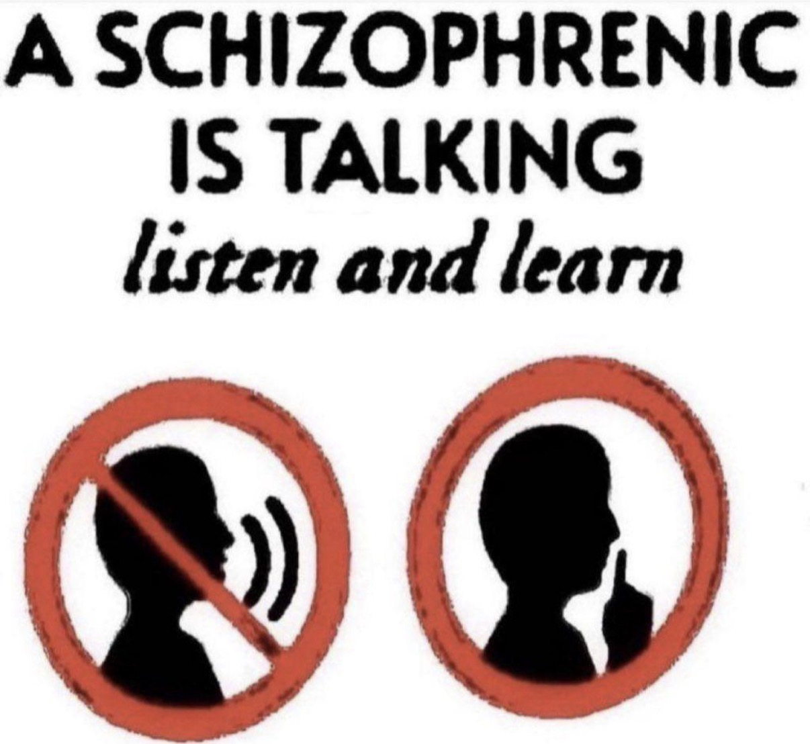

+++
slug = "life-update"
title = "Life Update"
date = "2026-11-09"
+++

Hey guys. Long time no see.

First of all, welcome to the new home of the blog. It's styled after bearblog websites but uses the hugo static site generator as the backend. I quite like the theming.

Secondofly, I have secured a full-time offer at Applied Intuition. Starting February, I will be working as a Core OS engineer in Sunnyvale. I'm glad I've been given the opportunity to pivot towards general-purpose operating systems as that's been a dream for me ever since I started being the OS TA. Plus, now I need to learn Rust for the job. And I get to work on Fuschia OS!!!

It's bittersweet leaving Austin; I've been here for the last 18 years of my life (since I was 5). I'm also feeling weird to be graduating, even though I'm 23 and it's long past overdue at this point. On the upside, I'll have two diplomas (like I'm Baby Keem). I'm finishing my last semester at UT and have some great stuff in the works to showcase on the blog; namely, my Multithreaded & GPU Programming/Architecture/Tools class will have a dope-ass final project that goes along with it, and if all goes well I'll be able to post it here. 

I've been spending the last few months with my friends, watching movies, going to the gym, and probably working too hard. I got a Mac Mini and I'm gonna try my hand at the whole music production thing again, this time in Logic.

As the OS TA, I've been doing some special-interest discussions as a replacement for recitation. Nobody seems to really give a shit, but I enjoy giving them anyways; it forces me to research and learn about things I'm not actively working on. My past few topics have been Memory Allocator Design, Microkernels, and Bootloaders.

I've been trying to start a org in my last semester. An org that I will never see the fruits of, or be a part of, or anything. But I think it needs to exist at the university. It's a spin on the [Austin Systems](https://austinsystems.org/) group that I've been to a couple times, but tailored towards giving students a space to share knowledge in the form of 45 minute lectures: the UT Systems Knowledge Share. I'm hoping it takes off (even though I won't be there to see it), and I'm working with Dr. Yerraballi to at least do some initial setup for it before I leave.

I don't know. Something this semester really clicked for me about why I love what I do. I love the idea that a finished product is a reflection of the work you put in and the things you learned along the way. I love explaining new concepts to people in creative ways. I love understanding how systems function, and being exposed to new technical challenges.

But man, AI has really been getting me down. It's definitely a productivity booster, and I use it to automate away the mundanity of SWE (for example, to theme this blog and do all the infra for the static site generation, or to rename variables), but it's really a bummer for education. My college degree has half been defined by low AI usage and half heavy AI usage, especially in the last two years, so I feel uniquely experienced to understand the advantages and pitfalls. And yeah, it turns out if you give every student a magic answer box for free, that will do whatever it can to make the end user happy, students are going to abuse it. Responsible AI use is a hard skill to master, and I've seen the smartest people I know succumb to the idea that they understand more than they do. 

On one hand, you could see this tool as a gift. We can now abstract away work just like in systems; dealing with the technically challenging portions ourselves, to further our understanding as an engineer, and leaving the monotony behind for the LLM. 

On the other hand, it's a curse. The younger and younger you go, AI use becomes a huge crutch and basically the best cheating tool in the world. It stifles creativity and curiosity, and makes every single thing you're doing driven by the end product rather than the process. And younger students have not developed the capacity to distinguish what they can abstract away because they understand it in its entirety, and what they are abstracting away because they don't want to go through the effort of trying to understand it. Hell, most of my age group relies on AI entirely.

My question is, should it ever have been up to us to decide what's "important" to pay attention to and what's not? Is making that decision ourselves what's stifling us?

I watched Her (2013) last night. Directed by Spike Jonze, it's a movie I first saw in 2020 (before GPT-3) and loved to death. The Arcade Fire soundtrack, the colors, and the montages moved me back then, but last night I was just disgusted. The AI revolution has really put that movie in a different perspective, and what was once an earnest story of love and heartbreak was now just seen as a freakazoid trying to convince us that we should be allowed to love our agentic LLMs. It's like, if a real alien abduction had just happened, and you started watching E.T., the decisions that kid makes about that little wrinkly alien may seem a lot more like stranger danger.

It's a weird spot to be in. Really understanding why you love what you do as soon as it's about to be replaced. Gaining a immense passion for portrait painting during the rise of the camera. We'll see; if my job ends up being the most boring thing in the world and I'm just hitting enter on Claude every day, it's not why I'm doing this. I'm not doing this for the money. So maybe a PhD is in the cards. We'll see.

There's only like four more weeks left of the semester, and then it all comes to an end. I hope the full-time life is kinder and I hope I can continue on my ever-growing personal project list (including probably WaddleOS lol).

Till next time,

-Ishan
